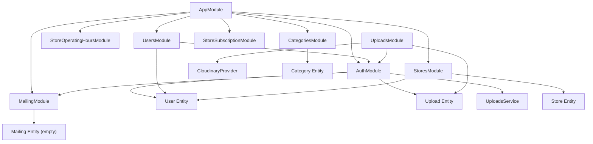
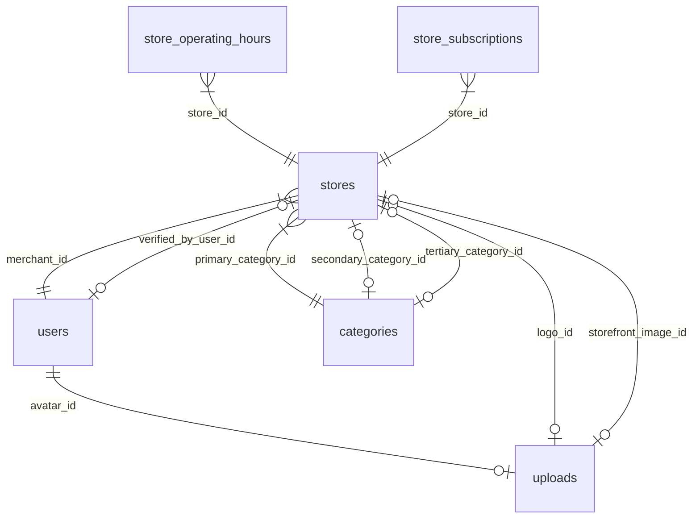

# WAY BACKEND — COMPREHENSIVE CODEBASE AUDIT REPORT

**Audit Date:** 19 November 2026  
**Auditor Role:** Senior Backend Engineer / NestJS Architect / Technical Auditor  
**Project:** WAY API Backend  
**Repository:** `way-api`  
**Last Commit:** `2ca97ef` — `feat(stores): add store and category management` (5 October 2026)

---

## 1. Executive Summary

The WAY backend is a **partially developed** NestJS REST API for a location-first retail navigation platform. Development began on 2 October 2026, with 6 commits across 3 days of active development, followed by approximately 6 weeks of inactivity.

### Current State at a Glance

| Area | Status |
|---|---|
| **Authentication (Local)** | IMPLEMENTED — registration, login, email verification, password reset all coded |
| **Authentication (Google OAuth)** | IMPLEMENTED — ID token verification with avatar ingestion |
| **KingsChat Authentication** | PLANNED — type interfaces exist, no implementation |
| **RBAC** | IMPLEMENTED — 4 roles, guard and decorator system in place |
| **User Management** | IMPLEMENTED — basic CRUD with admin-restricted listing |
| **Categories** | IMPLEMENTED — full CRUD with pagination and search |
| **Stores** | IMPLEMENTED — creation, listing, search, filtering, verification, soft-delete |
| **Uploads** | IMPLEMENTED — local storage engine with Cloudinary fallback available |
| **Mailing** | IMPLEMENTED — Brevo transactional email with Handlebars templates |
| **Store Operating Hours** | SCAFFOLD ONLY — entity defined, service is a NestJS generator stub |
| **Store Subscriptions** | SCAFFOLD ONLY — entity fully defined, service is a NestJS generator stub |
| **Products / Inventory** | MISSING — no implementation |
| **Reviews** | MISSING — no implementation |
| **Wallets / Transactions** | MISSING — no implementation |
| **Footfall Tracking** | MISSING — no implementation |
| **Firebase** | NOT PRESENT — no Firebase dependencies or implementation |
| **Tests** | MISSING — zero test files exist |

**The current development focus appears to be Store Operating Hours**, which has a well-designed entity but only a scaffold (NestJS CLI-generated) service and controller with no business logic.

---

## 2. Project Structure & Architecture

```
way-api/
├── db/
│   └── data-source.ts              # TypeORM DataSource configuration
├── dist/                            # Compiled output
├── guide/
│   └── way-product-brief.docx      # Product brief document
├── postman/
│   └── way-api-collections/        # Empty Postman collection directory
├── src/
│   ├── auth/                        # Authentication module
│   │   ├── decorator/               # @Roles() custom decorator
│   │   ├── dto/                     # Auth DTOs (Register, Login, etc.)
│   │   ├── entities/                # Empty Auth entity (unused)
│   │   ├── guard/                   # JwtAuthGuard + RolesGuard
│   │   ├── auth.controller.ts
│   │   ├── auth.module.ts
│   │   ├── auth.service.ts
│   │   └── auth.types.ts           # KingsChat + Google type interfaces
│   ├── categories/                  # Category management module
│   ├── config/
│   │   └── upload.cloudinary.ts     # Cloudinary provider configuration
│   ├── env/
│   │   └── index.ts                 # Centralised environment variable exports
│   ├── mailing/                     # Email service module (Brevo API)
│   │   └── templates/               # Handlebars HTML email templates
│   ├── stores/                      # Store management module
│   ├── store_operating_hours/       # Operating hours module (scaffold)
│   ├── store_subscription/          # Subscription module (scaffold)
│   ├── types/
│   │   └── express.d.ts             # Multer type augmentation
│   ├── uploads/                     # File upload module
│   ├── users/                       # User management module
│   ├── utils/
│   │   ├── convert.ts               # Currency conversion utility
│   │   └── date.ts                  # KingsChat date formatter
│   ├── app.controller.ts            # Root health-check controller
│   ├── app.module.ts                # Root application module
│   ├── app.service.ts               # Root service (Hello World)
│   └── main.ts                      # Application bootstrap
├── .env                             # Environment configuration
├── .gitignore
├── .prettierrc
├── eslint.config.mjs
├── nest-cli.json
├── package.json
├── pnpm-lock.yaml
├── README.md                        # Default NestJS README (unmodified)
├── tsconfig.build.json
└── tsconfig.json
```

### Module Dependency Graph



### Architectural Notes

- The application uses a **modular NestJS architecture** with clearly separated domain modules.
- All modules are registered in `AppModule` ([app.module.ts](file:///c:/Users/ryanf/Downloads/code/way-api/src/app.module.ts)).
- TypeORM is configured with `synchronize: true`, meaning the database schema is auto-generated from entities (acceptable for development, **dangerous for production**).
- No migration files exist — the project relies entirely on schema synchronisation.
- The `UploadsModule` is properly declared but is **not imported** in `AppModule`. It is only used through direct provider injection in `AuthModule`. The uploads controller is separately registered through its own module.

---

## 3. Technology Stack & Dependencies

### Runtime Dependencies

| Package | Version | Purpose | Usage Status |
|---|---|---|---|
| `@nestjs/common` | ^11.0.1 | NestJS core | ACTIVE |
| `@nestjs/config` | ^4.0.4 | Configuration module | ACTIVE (global) |
| `@nestjs/core` | ^11.0.1 | NestJS core | ACTIVE |
| `@nestjs/jwt` | ^11.0.2 | JWT authentication | ACTIVE |
| `@nestjs/mapped-types` | ^2.1.1 | DTO inheritance | ACTIVE |
| `@nestjs/platform-express` | ^11.0.1 | Express adapter | ACTIVE |
| `@nestjs/typeorm` | ^11.0.1 | TypeORM integration | ACTIVE |
| `axios` | ^1.17.0 | HTTP client | **UNUSED** — not imported anywhere |
| `bcryptjs` | ^3.0.3 | Password hashing | ACTIVE |
| `class-validator` | ^0.15.1 | DTO validation | ACTIVE |
| `cloudinary` | ^2.11.0 | Cloud storage | CONFIGURED — provider exists but active service uses local storage |
| `dotenv` | ^17.4.2 | Environment variables | ACTIVE |
| `form-data` | ^4.0.6 | Multipart form data | **UNUSED** — not imported |
| `google-auth-library` | ^10.7.0 | Google OAuth | ACTIVE |
| `handlebars` | ^4.7.9 | Email templates | ACTIVE |
| `mailgun.js` | ^13.2.0 | Mailgun email | **UNUSED** — superseded by Brevo |
| `mysql` | ^2.18.1 | MySQL driver | ACTIVE |
| `nestjs-paginate` | ^15.0.1 | Pagination | ACTIVE |
| `reflect-metadata` | ^0.2.2 | Decorator metadata | ACTIVE |
| `resend` | ^6.12.4 | Resend email | **PARTIALLY USED** — instantiated in AuthService but all sending goes through MailingService/Brevo |
| `rxjs` | ^7.8.1 | Reactive extensions | ACTIVE (NestJS core) |
| `streamifier` | ^0.1.1 | Buffer to stream | Used in Cloudinary service variant |
| `typeorm` | ^0.3.29 | ORM | ACTIVE |
| `uuid` | ^14.0.0 | UUID generation | ACTIVE |

### Notable Observations

- **`class-transformer` is NOT installed** despite being commonly expected with `class-validator` in NestJS projects. This means `@Transform()` and `@Exclude()` decorators are unavailable, and `enableImplicitConversion` for validation pipes cannot be used.
- **No global `ValidationPipe`** is configured in `main.ts`. DTO validation decorators exist but will NOT enforce validation unless a `ValidationPipe` is applied globally or per-endpoint. This is a **CRITICAL gap**.
- **No `@nestjs/swagger` package** is installed — no Swagger/OpenAPI documentation is configured.
- Three email libraries are installed (`mailgun.js`, `resend`, Brevo via `fetch`), but only Brevo is actively used.
- `axios` and `form-data` are installed but unused — likely carried over from a previous project.

### Application Bootstrap Configuration

**File:** [src/main.ts](file:///c:/Users/ryanf/Downloads/code/way-api/src/main.ts)

| Setting | Value |
|---|---|
| Global API Prefix | `api/v1` |
| CORS Origin | `http://localhost:3300` (single origin, restrictive) |
| CORS Methods | `HEAD,GET,PUT,PATCH,POST,DELETE` |
| CORS Credentials | `true` |
| Port | `process.env.PORT ?? 3300` |
| Global Validation Pipe | **NOT CONFIGURED** |
| Global Exception Filter | **NOT CONFIGURED** |
| Swagger | **NOT CONFIGURED** |
| Helmet / Rate Limiting | **NOT CONFIGURED** |
| Static File Serving | **NOT CONFIGURED** (uploads served from local disk but no static handler) |
| Logging | Default NestJS logger |

---

## 4. Authentication & User Management

### 4.1 User Entity

**File:** [src/users/entities/users.entity.ts](file:///c:/Users/ryanf/Downloads/code/way-api/src/users/entities/users.entity.ts)

**Table:** `users`

| Column | Type | Nullable | Default | Unique | Notes |
|---|---|---|---|---|---|
| `id` | `int unsigned` | NO | AUTO_INCREMENT | PK | |
| `fullname` | `varchar(255)` | NO | - | NO | |
| `username` | `varchar(255)` | YES | NULL | NO | No unique constraint defined |
| `bio` | `varchar(500)` | YES | NULL | NO | |
| `location` | `varchar(500)` | YES | NULL | NO | |
| `email` | `varchar(255)` | NO | - | YES | |
| `password` | `varchar(255)` | YES | NULL | NO | Nullable for OAuth users |
| `phone_number` | `varchar(20)` | YES | NULL | YES | |
| `date_of_birth` | `timestamp` | YES | NULL | NO | |
| `gender` | `enum('male','female')` | NO | `'male'` | NO | Defaults all users to male |
| `avatar_id` | `int unsigned` | YES | NULL | NO | FK → uploads |
| `role` | `enum` | NO | `'user'` | NO | user/merchant/admin/admin_staff |
| `status` | `enum` | NO | `'active'` | NO | active/pending/suspended |
| `provider` | `enum` | NO | `'local'` | NO | local/google/apple |
| `google_id` | `varchar` | YES | NULL | YES | |
| `apple_id` | `varchar` | YES | NULL | YES | |
| `email_verified` | `boolean` | NO | `false` | NO | |
| `phone_verified` | `boolean` | NO | `false` | NO | |
| `verification_token` | `varchar(100)` | YES | NULL | NO | Shared for email verify + password reset |
| `reset_password_token` | `varchar(100)` | YES | NULL | NO | Exists but **unused** — `verification_token` is used instead |
| `reset_password_expires` | `timestamp` | YES | NULL | NO | Exists but **unused** |
| `created_at` | `timestamp` | NO | CURRENT_TIMESTAMP | NO | |
| `updated_at` | `timestamp` | NO | CURRENT_TIMESTAMP | NO | |
| `deleted_at` | `timestamp` | YES | NULL | NO | Soft delete |

**Enums:**
- `UserRole`: `user`, `merchant`, `admin`, `admin_staff`
- `UserStatus`: `active`, `pending`, `suspended`
- `AuthProvider`: `local`, `google`, `apple`
- `UserGender`: `male`, `female`

**Relationships:**
- `avatar` → `Upload` (ManyToOne, eager, onDelete: SET NULL)

### 4.2 Registration

**File:** [src/auth/auth.service.ts#L156-L196](file:///c:/Users/ryanf/Downloads/code/way-api/src/auth/auth.service.ts#L156-L196)

| Feature | Status | Notes |
|---|---|---|
| Email registration | IMPLEMENTED | Full flow with hashed password |
| Duplicate email check | IMPLEMENTED | Returns 400 if exists |
| Password hashing | IMPLEMENTED | bcryptjs with 10 salt rounds |
| Auto-username generation | IMPLEMENTED | Base name + 4-digit random |
| Email verification token | IMPLEMENTED | 6-digit numeric code |
| Verification email sending | IMPLEMENTED | Via MailingService → Brevo |
| Token returned immediately | YES | User gets JWT before email verification |

> [!WARNING]
> **No password strength validation.** The `RegisterDto` only validates that `password` is a string. No minimum length, complexity, or format requirements are enforced. A single-character password would be accepted.

### 4.3 Login

**File:** [src/auth/auth.service.ts#L220-L256](file:///c:/Users/ryanf/Downloads/code/way-api/src/auth/auth.service.ts#L220-L256)

- Local login checks email, verifies password hash via `bcrypt.compare`.
- Uses explicit `select` to include the normally-excluded `password` field.
- Returns JWT token + user data on success.
- **Does NOT check if `email_verified` is true.** An unverified user can login.
- **Does NOT check if user `status` is `active`.** A suspended user can login.

### 4.4 Email Verification

**File:** [src/auth/auth.controller.ts#L51-L59](file:///c:/Users/ryanf/Downloads/code/way-api/src/auth/auth.controller.ts#L51-L59)

> [!CAUTION]
> **BUG:** The `verifyEmail` endpoint is defined as `@Get('verify-email')` but the `res` parameter is not decorated with `@Res()`. NestJS will treat it as a query parameter, causing the redirect to fail with a runtime error. The `@Res()` decorator is missing.

### 4.5 Password Reset

**File:** [src/auth/auth.service.ts#L261-L310](file:///c:/Users/ryanf/Downloads/code/way-api/src/auth/auth.service.ts#L261-L310)

- Forgot password generates a 6-digit code and stores it in `verification_token`.
- Reset password verifies the code and updates the password.
- **Code has no expiration.** The `reset_password_expires` column exists on the entity but is never used.
- **Verification token is shared** between email verification and password reset. A pending email verification token would be overwritten by a password reset request.

### 4.6 Profile Update

**File:** [src/auth/auth.service.ts#L313-L332](file:///c:/Users/ryanf/Downloads/code/way-api/src/auth/auth.service.ts#L313-L332)

- Protected by `JwtAuthGuard`.
- Username uniqueness check is implemented.
- Uses `Object.assign(user, dto)` — this means any field in the DTO can overwrite the entity.

> [!WARNING]
> **The `UpdateProfileDto` includes fields like `avatar` as a plain string, but the User entity uses `avatar_id` (FK to Upload).** The DTO field `avatar` doesn't map to any entity column — it would be silently ignored by TypeORM, or could cause unexpected behaviour.

### 4.7 Logout

**File:** [src/auth/auth.service.ts#L335-L344](file:///c:/Users/ryanf/Downloads/code/way-api/src/auth/auth.service.ts#L335-L344)

- **Non-functional.** The logout endpoint exists but does nothing meaningful.
- It finds the user and saves them (no changes).
- Comment says "handle this client-side by deleting the token."
- The endpoint is not protected by `JwtAuthGuard`, so the `req.user` object will not exist — this will throw a runtime error.
- No token blacklisting or refresh token invalidation.

### 4.8 JWT Configuration

**File:** [src/auth/auth.module.ts#L15-L18](file:///c:/Users/ryanf/Downloads/code/way-api/src/auth/auth.module.ts#L15-L18)

| Setting | Value |
|---|---|
| Secret | From `JWT_SECRET` env var |
| Expiration | 7 days |
| Algorithm | Default (HS256) |
| Refresh Tokens | NOT IMPLEMENTED |
| Token Payload | `{ id, name }` (user ID and fullname) |

> [!NOTE]
> The JWT token does not include the user's `role` in the payload. The `JwtAuthGuard` performs a database lookup on every authenticated request to get the full user object, which is why role checks work. This is functional but adds a DB query to every protected request.

---

## 5. Google OAuth Audit

**File:** [src/auth/auth.service.ts#L123-L154](file:///c:/Users/ryanf/Downloads/code/way-api/src/auth/auth.service.ts#L123-L154)

### Implementation Approach

Google OAuth is implemented using `google-auth-library` (not Passport.js). The flow is:

1. Frontend/mobile obtains a Google ID token (client-side OAuth).
2. Backend receives the ID token via `POST /api/v1/auth/google`.
3. Backend verifies the token using `OAuth2Client.verifyIdToken()`.
4. If the user's Google profile picture exists, it is downloaded and saved via the upload service.
5. User is found or created using `createOrLoginGoogleUser()`.
6. JWT token is returned.

### Assessment

| Feature | Status |
|---|---|
| Token verification | IMPLEMENTED — verifies against `GOOGLE_CLIENT_ID` |
| New user creation | IMPLEMENTED — creates with `AuthProvider.GOOGLE`, email pre-verified |
| Existing user linking | IMPLEMENTED — matches by `google_id` first, then by email |
| Avatar ingestion | IMPLEMENTED — downloads Google profile photo, saves via local upload service |
| JWT token issuance | IMPLEMENTED |
| Account merging | PARTIAL — existing email user gets `google_id` set, but no password conflict handling |
| Frontend callback flow | YES — stateless ID token approach works for mobile/SPA |

> [!NOTE]
> The Google OAuth approach is **modern and well-suited for mobile apps**. It avoids server-side OAuth redirects and callback URLs, relying on the client to perform the OAuth flow and simply passing the ID token to the backend for verification.

---

## 6. KingsChat Integration Status

### Evidence Found

| Location | Content | Type |
|---|---|---|
| [src/auth/auth.types.ts#L1-L57](file:///c:/Users/ryanf/Downloads/code/way-api/src/auth/auth.types.ts#L1-L57) | Complete TypeScript interfaces for KingsChat API response structures | Type definitions only |
| [src/utils/date.ts](file:///c:/Users/ryanf/Downloads/code/way-api/src/utils/date.ts) | `formatKingsChatDate()` utility function for converting KingsChat millisecond timestamps | Utility only |

### Status: PLANNED

KingsChat integration has **no functional implementation**. What exists:

- **Detailed type interfaces** that model the KingsChat user profile API response, including: user profile, presence, email, gender, phone number, country code, barcode, cloud space, and social connections.
- **A date conversion utility** for KingsChat's millisecond timestamp format.

What is **absent**:

- No KingsChat OAuth strategy or callback route.
- No KingsChat environment variables in `.env` or `src/env/index.ts`.
- No KingsChat-related service methods.
- No controller endpoints for KingsChat authentication.
- No KingsChat SDK or API client dependency.

### Integration Readiness

The existing architecture is well-prepared for KingsChat integration:

1. The `AuthProvider` enum would need a `KINGSCHAT = 'kingschat'` value added.
2. A `kingschat_id` column would need to be added to the User entity.
3. A KingsChat OAuth flow would follow the same pattern as the Google implementation: verify token → map profile → find-or-create user → issue JWT.
4. The type interfaces in `auth.types.ts` provide the complete data mapping needed.
5. The `formatKingsChatDate()` utility in `src/utils/date.ts` is ready for date-of-birth conversion.

---

## 7. RBAC & Access Control

### Role Definitions

**File:** [src/users/entities/users.entity.ts#L13-L18](file:///c:/Users/ryanf/Downloads/code/way-api/src/users/entities/users.entity.ts#L13-L18)

| Role | Value | Description |
|---|---|---|
| `USER` | `'user'` | Consumer / Default role |
| `MERCHANT` | `'merchant'` | Store owner |
| `ADMIN` | `'admin'` | Super administrator |
| `ADMIN_STAFF` | `'admin_staff'` | Staff member |

### Guard Implementation

- **JwtAuthGuard** ([src/auth/guard/auth.guard.ts](file:///c:/Users/ryanf/Downloads/code/way-api/src/auth/guard/auth.guard.ts)): Verifies JWT token and loads full user from database into `request.user`.
- **RolesGuard** ([src/auth/guard/roles.guard.ts](file:///c:/Users/ryanf/Downloads/code/way-api/src/auth/guard/roles.guard.ts)): Checks `request.user.role` against required roles. **ADMIN role has super-admin override** — can access any role-protected endpoint.
- **Roles Decorator** ([src/auth/decorator/roles.decorator.ts](file:///c:/Users/ryanf/Downloads/code/way-api/src/auth/decorator/roles.decorator.ts)): `@Roles(UserRole.MERCHANT)` metadata decorator.

### Role Enforcement by Endpoint

| Endpoint | Guards Applied | Roles Required | Assessment |
|---|---|---|---|
| `POST /auth/register` | None | Public | ✅ Correct |
| `POST /auth/login` | None | Public | ✅ Correct |
| `POST /auth/google` | None | Public | ✅ Correct |
| `GET /auth/me` | None (manual token check) | Any authenticated | ⚠️ Inconsistent — should use JwtAuthGuard |
| `GET /auth/verify-email` | None | Public | ✅ Correct |
| `POST /auth/forgot-password` | None | Public | ✅ Correct |
| `POST /auth/reset-password` | None | Public | ✅ Correct |
| `PATCH /auth/update-profile` | JwtAuthGuard | Any authenticated | ✅ Correct |
| `POST /auth/logout` | None | None | ❌ **UNPROTECTED** — `req.user` will be undefined |
| `GET /users` | JwtAuthGuard + RolesGuard | ADMIN | ✅ Correct |
| `GET /users/:id` | None | Public | ⚠️ **Anyone can view any user profile** |
| `PATCH /users/:id` | None | Public | ❌ **CRITICAL: Anyone can update any user** |
| `DELETE /users/:id` | None | Public | ❌ **CRITICAL: Anyone can delete any user** |
| `POST /stores` | JwtAuthGuard + RolesGuard | MERCHANT, ADMIN | ✅ Correct |
| `GET /stores` | None | Public | ✅ Correct |
| `GET /stores/:id` | None | Public | ✅ Correct |
| `PATCH /stores/:id` | JwtAuthGuard + RolesGuard | MERCHANT, ADMIN | ⚠️ No ownership check |
| `PATCH /stores/:id/verify` | JwtAuthGuard + RolesGuard | ADMIN, ADMIN_STAFF | ✅ Correct |
| `DELETE /stores/:id` | JwtAuthGuard + RolesGuard | MERCHANT, ADMIN | ⚠️ No ownership check |
| `POST /categories` | None | Public | ⚠️ **Anyone can create categories** |
| `GET /categories` | None | Public | ✅ Correct |
| `GET /categories/:id` | None | Public | ✅ Correct |
| `PATCH /categories/:id` | None | Public | ⚠️ **Anyone can update categories** |
| `DELETE /categories/:id` | None | Public | ⚠️ **Anyone can delete categories** |
| `POST /uploads` | JwtAuthGuard | Any authenticated | ✅ Correct |
| `GET /uploads` | JwtAuthGuard | Any authenticated | ✅ Correct |
| `GET /uploads/:id` | JwtAuthGuard | Any authenticated | ✅ Correct |
| `DELETE /uploads/:id` | None | Public | ❌ **Anyone can delete uploads** |
| `POST /mailing/send-manual` | None | Public | ❌ **CRITICAL: Anyone can send emails** |
| All `store-operating-hours` | None | Public | ⚠️ Scaffold — no guards applied |
| All `store-subscription` | None | Public | ⚠️ Scaffold — no guards applied |

---

## 8. Database & Entity Architecture

### Database Configuration

**File:** [db/data-source.ts](file:///c:/Users/ryanf/Downloads/code/way-api/db/data-source.ts)

| Setting | Value |
|---|---|
| Type | MySQL |
| Host | `DB_HOST` env var |
| Port | `DB_PORT` env var (default 3306) |
| Synchronize | **`true`** |
| Entity Discovery | `dist/**/*.entity.js` (glob pattern) |
| Migration Path | `dist/db/migrations/*.js` |

> [!WARNING]
> `synchronize: true` must be disabled before any production deployment. It auto-alters database tables to match entity definitions, which can cause data loss.

### Entity Registry

| Entity | Table Name | File | TypeORM Registered | Has Service | Has Controller | Has DTOs | Has Migrations |
|---|---|---|---|---|---|---|---|
| `User` | `users` | [users.entity.ts](file:///c:/Users/ryanf/Downloads/code/way-api/src/users/entities/users.entity.ts) | ✅ | ✅ | ✅ | ⚠️ Empty | NO |
| `Upload` | `uploads` | [upload.entity.ts](file:///c:/Users/ryanf/Downloads/code/way-api/src/uploads/entities/upload.entity.ts) | ✅ | ✅ | ✅ | ⚠️ Empty | NO |
| `Category` | `categories` | [category.entity.ts](file:///c:/Users/ryanf/Downloads/code/way-api/src/categories/entities/category.entity.ts) | ✅ | ✅ | ✅ | ✅ | NO |
| `Store` | `stores` | [store.entity.ts](file:///c:/Users/ryanf/Downloads/code/way-api/src/stores/entities/store.entity.ts) | ✅ | ✅ | ✅ | ✅ | NO |
| `StoreOperatingHours` | `store_operating_hours` | [store_operating_hour.entity.ts](file:///c:/Users/ryanf/Downloads/code/way-api/src/store_operating_hours/entities/store_operating_hour.entity.ts) | ⚠️ Not in TypeORM.forFeature | ⚠️ Stub | ⚠️ Stub | ⚠️ Empty | NO |
| `StoreSubscription` | `store_subscriptions` | [store_subscription.entity.ts](file:///c:/Users/ryanf/Downloads/code/way-api/src/store_subscription/entities/store_subscription.entity.ts) | ⚠️ Not in TypeORM.forFeature | ⚠️ Stub | ⚠️ Stub | ⚠️ Empty | NO |
| `Auth` | - | [auth.entity.ts](file:///c:/Users/ryanf/Downloads/code/way-api/src/auth/entities/auth.entity.ts) | NO | - | - | - | - |
| `Mailing` | - | [mailing.entity.ts](file:///c:/Users/ryanf/Downloads/code/way-api/src/mailing/entities/mailing.entity.ts) | ⚠️ In forFeature but empty class | - | - | - | - |

### Missing Expected Entities

| Entity | Status |
|---|---|
| `products` | MISSING |
| `product_images` | MISSING |
| `store_wallets` | MISSING |
| `wallet_transactions` | MISSING |
| `footfall_logs` | MISSING |
| `reviews` | MISSING |

### Relationship Map



### Database Integrity Concerns

1. **`StoreOperatingHours` entity is NOT registered with TypeORM** in its module — `StoreOperatingHoursModule` does not call `TypeOrmModule.forFeature([StoreOperatingHours])`. The entity will only be picked up because the DataSource uses a glob pattern for entity discovery, so the **table will be created** by synchronize, but the **repository will not be injectable** in the service.

2. **`StoreSubscription` entity is NOT registered with TypeORM** in its module — same issue as above.

3. **`Mailing` entity** is registered in `MailingModule` via `TypeOrmModule.forFeature([Mailing])` but the entity class is empty (`export class Mailing {}`). It has no `@Entity()` decorator and no columns. This will cause a TypeORM error at startup or be silently ignored.

4. **`username` on User entity lacks a unique constraint** in the database column definition (only has `nullable: true, type: 'varchar'`). The application-level uniqueness check in `updateProfile` could have race conditions.

5. **Gender defaults to `'male'`** for all new users, including Google OAuth users. This is a data quality issue.

6. **No index on `users.email`** — although it has a unique constraint (which typically creates an index in MySQL), there is no explicit `@Index()` decorator.

7. **`verification_token` column is shared** between email verification and password reset. There is a separate `reset_password_token` column that is never used.

8. **Category entity references `sub_categories` relation** in `findOne()` service method ([categories.service.ts#L48](file:///c:/Users/ryanf/Downloads/code/way-api/src/categories/categories.service.ts#L48)), but this relationship does not exist on the Category entity. This will cause a runtime error.

---

## 9. Media Upload & File Management

### Upload Entity

**File:** [src/uploads/entities/upload.entity.ts](file:///c:/Users/ryanf/Downloads/code/way-api/src/uploads/entities/upload.entity.ts)

| Column | Type | Purpose |
|---|---|---|
| `id` | `int unsigned` PK | Auto-increment ID |
| `url` | `varchar` | Full URL to file |
| `public_id` | `varchar` | Cloudinary public_id or local path |
| `asset_id` | `varchar` | UUID identifier |
| `type` | `varchar` | Folder/purpose classification |
| `resource_type` | `enum('image','video','raw','application')` | Media type |
| `created_at` | `timestamp` | Auto |
| `updated_at` | `timestamp` | Auto |

### Storage Architecture

The project has **two upload service implementations**:

1. **Active Service:** [uploads.service.ts](file:///c:/Users/ryanf/Downloads/code/way-api/src/uploads/uploads.service.ts) — Uses `LocalStorageEngine` to write files to `public/uploads/` on the local filesystem.
2. **Inactive Service:** [uploads.service.cloudinary.ts](file:///c:/Users/ryanf/Downloads/code/way-api/src/uploads/uploads.service.cloudinary.ts) — Uses Cloudinary SDK for cloud storage. **Not currently loaded** as the active service shares the same class name.

### Local Storage Engine

**File:** [src/uploads/local-storage.engine.ts](file:///c:/Users/ryanf/Downloads/code/way-api/src/uploads/local-storage.engine.ts)

- Writes files to `{project_root}/public/uploads/{type}/{filename}`.
- Supports types: `media-images`, `media-videos`, `event-images`, `event-videos`, `user-profile`, `user-wallphoto`, `general`.
- Delete function uses regex matching to find files by relative URL.
- **No static file serving configured in `main.ts`** — uploaded files cannot be accessed via HTTP even though URLs are stored in the database.

### URL-Based Upload

**File:** [src/uploads/uploads.service.ts#L57-L99](file:///c:/Users/ryanf/Downloads/code/way-api/src/uploads/uploads.service.ts#L57-L99)

- `uploadFileFromUrl()` can download an image from a URL and save it locally.
- Used by Google OAuth to ingest Google profile pictures.
- Mocks `Express.Multer.File` interface from the downloaded buffer.

### Security Concerns

> [!CAUTION]
> 1. **No file type validation.** Any file type can be uploaded — no MIME type whitelist.
> 2. **No file size limit configured.** The `FilesInterceptor` has a max count of 10 but no `fileSize` limit.
> 3. **No ownership tracking.** Uploads have no `uploaded_by` column — anyone can delete any upload.
> 4. **`DELETE /uploads/:id` is UNPROTECTED** — no `JwtAuthGuard`.

### Upload References

| Entity | Column | Relationship |
|---|---|---|
| `User` | `avatar_id` | ManyToOne → Upload (eager, SET NULL) |
| `Store` | `logo_id` | ManyToOne → Upload (SET NULL) |
| `Store` | `storefront_image_id` | ManyToOne → Upload (SET NULL) |

The upload architecture is centralised as intended — entities reference uploads by FK ID rather than storing URLs directly.

---

## 10. Store Management

### Store Entity

**File:** [src/stores/entities/store.entity.ts](file:///c:/Users/ryanf/Downloads/code/way-api/src/stores/entities/store.entity.ts)

The Store entity is **comprehensively designed** with 35+ columns covering:

- **Business Identity:** name, slug, legal_name, rc_number, tax_id, description
- **Contact:** contact_email, primary_phone, secondary_phone, website_url
- **Visual Assets:** logo_id → Upload, storefront_image_id → Upload
- **Physical Location:** address_line, unit_suite, landmark, city, state, country, postal_code, latitude (indexed), longitude (indexed)
- **Verification:** verification_status (enum), verification_notes, verified_at, verified_by_user_id
- **Operational State:** is_active, is_open_override
- **Metrics:** rating_avg, review_count, footfall_count
- **Classification:** store_type (retail/service/hybrid), primary/secondary/tertiary category IDs
- **Verified Badge:** has_verified_badge (indexed), verified_badge_expires_at
- **Timestamps:** created_at, updated_at, deleted_at (soft delete)

### Store Service

**File:** [src/stores/stores.service.ts](file:///c:/Users/ryanf/Downloads/code/way-api/src/stores/stores.service.ts)

| Method | Status | Notes |
|---|---|---|
| `create()` | IMPLEMENTED | Auto-generates slug from name + timestamp |
| `findAll()` | IMPLEMENTED | Full pagination with nestjs-paginate |
| `findOne()` | IMPLEMENTED | Loads categories, logo, storefront_image, merchant |
| `update()` | IMPLEMENTED | Re-generates slug if name changes |
| `verifyStore()` | IMPLEMENTED | Sets status, admin ID, timestamp, notes |
| `remove()` | IMPLEMENTED | Soft delete via `softDelete()` |

### Search & Filtering

The `findAll()` method configures extensive search and filter capabilities:

| Feature | Type | Columns |
|---|---|---|
| **Sortable** | Sorting | id, name, rating_avg, review_count, created_at |
| **Searchable** | Full-text search | name, legal_name, description, address_line, landmark, city |
| **Filterable** | Query filters | primary/secondary/tertiary_category_id, verification_status, store_type, is_active, city, state |
| **Relations** | Eager loaded | primary_category, secondary_category, tertiary_category, logo, storefront_image |

### Store Verification

The verification system is **well-implemented**:

- `PATCH /stores/:id/verify` — restricted to ADMIN and ADMIN_STAFF roles.
- Accepts `VerifyStoreDto` with `status` (enum) and optional `notes`.
- Records `verified_by_user_id` and `verified_at` timestamp.
- Verification notes serve as feedback for rejected stores.

> [!WARNING]
> **Missing ownership checks on store update and delete.** A MERCHANT can update or delete **any** store, not just their own. The service does not verify that `req.user.id === store.merchant_id`. The `update()` method does not receive or check the authenticated user ID.

---

## 11. Store Operating Hours — Current Development Focus

### Status: SCAFFOLD ONLY (IN PROGRESS)

This module has been generated by the NestJS CLI (`nest g resource store_operating_hours`) but only the **entity** has been developed. The service, controller, and DTOs remain as untouched scaffolds.

### Entity (Well Designed)

**File:** [src/store_operating_hours/entities/store_operating_hour.entity.ts](file:///c:/Users/ryanf/Downloads/code/way-api/src/store_operating_hours/entities/store_operating_hour.entity.ts)

| Column | Type | Nullable | Notes |
|---|---|---|---|
| `id` | `int unsigned` PK | NO | Auto-increment |
| `store_id` | `int unsigned` | NO | FK → stores |
| `day_of_week` | `enum` | NO | monday–sunday |
| `open_time` | `time` | YES | e.g., "08:00:00" |
| `close_time` | `time` | YES | e.g., "18:00:00" |
| `is_closed` | `boolean` | NO | Default: false |

**Unique constraint:** `['store_id', 'day_of_week']` — prevents duplicate day entries per store.

**DayOfWeek enum:** `monday`, `tuesday`, `wednesday`, `thursday`, `friday`, `saturday`, `sunday`

### Service (Stub)

**File:** [src/store_operating_hours/store_operating_hours.service.ts](file:///c:/Users/ryanf/Downloads/code/way-api/src/store_operating_hours/store_operating_hours.service.ts)

All methods return placeholder strings. No database interaction exists.

```typescript
// ACTUAL CURRENT IMPLEMENTATION — no business logic
create() { return 'This action adds a new storeOperatingHour'; }
findAll() { return 'This action returns all storeOperatingHours'; }
findOne(id) { return `This action returns a #${id} storeOperatingHour`; }
update(id) { return `This action updates a #${id} storeOperatingHour`; }
remove(id) { return `This action removes a #${id} storeOperatingHour`; }
```

### Controller (Stub)

**File:** [src/store_operating_hours/store_operating_hours.controller.ts](file:///c:/Users/ryanf/Downloads/code/way-api/src/store_operating_hours/store_operating_hours.controller.ts)

Standard CRUD routes without authentication guards or role restrictions.

### Module (Incomplete)

**File:** [src/store_operating_hours/store_operating_hours.module.ts](file:///c:/Users/ryanf/Downloads/code/way-api/src/store_operating_hours/store_operating_hours.module.ts)

- Does **NOT** import `TypeOrmModule.forFeature([StoreOperatingHours])`.
- Does **NOT** import `Store` entity or `User` entity for ownership verification.
- Cannot inject the `StoreOperatingHours` repository.

### DTOs (Empty)

- `CreateStoreOperatingHourDto` — empty class, no validation decorators.
- `UpdateStoreOperatingHourDto` — extends empty create DTO via `PartialType`.

### Component Implementation Status

| Component | Status |
|---|---|
| Entity defined | ✅ COMPLETE |
| Table configuration (unique, FK) | ✅ COMPLETE |
| Store relationship | ✅ COMPLETE |
| Day-of-week enum | ✅ COMPLETE |
| Closed-day handling | ✅ COMPLETE (via `is_closed` boolean) |
| TypeORM registration in module | ❌ MISSING |
| DTOs with validation | ❌ MISSING |
| Service with database operations | ❌ MISSING |
| Controller with guards | ❌ MISSING |
| Merchant ownership checks | ❌ MISSING |
| Batch set/update weekly schedule | ❌ MISSING |
| Open Now query functionality | ❌ MISSING |
| Integration with Store discovery | ❌ MISSING |
| Overnight hours handling | ❌ NOT DESIGNED |
| Timezone consideration | ❌ NOT DESIGNED |

---

## 12. Store Subscriptions & Verified Badge

### Status: SCAFFOLD ONLY

### Entity (Well Designed)

**File:** [src/store_subscription/entities/store_subscription.entity.ts](file:///c:/Users/ryanf/Downloads/code/way-api/src/store_subscription/entities/store_subscription.entity.ts)

| Column | Type | Notes |
|---|---|---|
| `id` | `int unsigned` PK | |
| `store_id` | `int unsigned` FK | Indexed |
| `plan_type` | `varchar(100)` | Default: 'verified_badge' |
| `status` | `enum` | active/past_due/canceled/expired |
| `payment_provider` | `varchar(50)` | e.g., 'paystack', 'stripe' |
| `provider_subscription_id` | `varchar(255)` | External subscription reference |
| `provider_customer_id` | `varchar(255)` | External customer reference |
| `payment_method` | `varchar(50)` | e.g., 'card', 'bank_transfer' |
| `currency` | `varchar(3)` | Default: 'NGN' |
| `amount_paid` | `decimal(12,2)` | |
| `starts_at` | `timestamp` | |
| `expires_at` | `timestamp` | |
| `auto_renew` | `boolean` | Default: true |
| `created_at` | `timestamp` | |
| `updated_at` | `timestamp` | |

### Service (Stub)

All methods return placeholder strings — identical to the operating hours scaffold.

### Controller (Stub)

Standard CRUD routes, no authentication guards.

### What is MISSING

| Component | Status |
|---|---|
| TypeORM registration in module | ❌ MISSING |
| DTOs with validation | ❌ MISSING (empty) |
| Service business logic | ❌ MISSING |
| Payment provider integration | ❌ MISSING |
| Webhook handling | ❌ MISSING |
| Subscription activation | ❌ MISSING |
| Subscription cancellation | ❌ MISSING |
| Expiration handling | ❌ MISSING |
| Scheduled expiration jobs | ❌ MISSING |
| Verified badge sync to Store entity | ❌ MISSING |
| Guards and role restrictions | ❌ MISSING |

### Verified Badge Architecture

The Store entity has two relevant fields:
- `has_verified_badge: boolean` — fast UI check
- `verified_badge_expires_at: Date` — expiry tracking

These fields exist on the Store entity but are **not managed by any service or cron job**. There is no mechanism to synchronise `has_verified_badge` with the subscription state.

---

## 13. Firebase Integration & Access Control

### Status: NOT PRESENT

There is **no Firebase implementation** in this project.

| Search | Result |
|---|---|
| Firebase dependencies in package.json | NONE |
| Firebase imports in source files | NONE |
| Firebase environment variables | NONE |
| Firebase service account references | NONE |
| Firebase Admin SDK | NOT INSTALLED |
| Firebase Auth | NOT USED |
| Firebase Cloud Messaging | NOT PRESENT |

The authentication and access control architecture is entirely JWT + RBAC based, using `@nestjs/jwt` and custom guards. There is no Firebase overlap or conflict.

---

## 14. Other Modules & External Integrations

### 14.1 Mailing Service

**File:** [src/mailing/mailing.service.ts](file:///c:/Users/ryanf/Downloads/code/way-api/src/mailing/mailing.service.ts)

| Feature | Status |
|---|---|
| Email provider | Brevo (Sendinblue) via REST API |
| Template engine | Handlebars with HTML templates |
| Template resolution | Production (dist/) then development (src/) fallback |
| Verification emails | IMPLEMENTED |
| Welcome emails | IMPLEMENTED |
| Password reset emails | IMPLEMENTED |
| Generic/manual emails | IMPLEMENTED |
| Donor-related emails | IMPLEMENTED (carried over from previous project) |

**Available Templates:**
- `email-verification.html`
- `welcome.html`
- `donation-success.html` (from previous project)
- `new-donation.html` (from previous project)
- `generic-manual-email.html`

> [!NOTE]
> The mailing service contains **donor/donation-related methods** (`sendDonorSuccessEmail`, `sendOwnerNotification`, `sendGoalReachedEmail`) that are clearly from a previous project (likely a donation/fundraising platform). These methods are unused in WAY and should be cleaned up. The sender name in env defaults to "Way Navigation" but the sender email references "theinnercitymission.net".

### 14.2 Mailing Controller

**File:** [src/mailing/mailing.controller.ts](file:///c:/Users/ryanf/Downloads/code/way-api/src/mailing/mailing.controller.ts)

> [!CAUTION]
> **CRITICAL SECURITY ISSUE:** `POST /api/v1/mailing/send-manual` is completely unprotected. Anyone can send arbitrary emails through the platform's email infrastructure. The comment says "Add your Admin Guard here later" — this guard has not been added.

### 14.3 Cloudinary Configuration

**File:** [src/config/upload.cloudinary.ts](file:///c:/Users/ryanf/Downloads/code/way-api/src/config/upload.cloudinary.ts)

Cloudinary is configured as a provider but the active upload service uses local storage. Environment variables are defined for `CLOUDINARY_CLOUD_NAME`, `CLOUDINARY_API_KEY`, and `CLOUDINARY_API_SECRET`.

### 14.4 Payment Gateway References

The environment configuration references **three payment providers**, none of which are implemented:

| Provider | Variables Defined | Implementation |
|---|---|---|
| Paystack | `PAYSTACK_SECRET_KEY` | NONE |
| Stripe | `STRIPE_PUBLIC_KEY`, `STRIPE_SECRET_KEY`, `STRIPE_WEBHOOK_SECRET` | NONE |
| PayPal | `PAYPAL_CLIENT_ID`, `PAYPAL_SECRET_KEY`, `PAYPAL_API` | NONE |

> [!NOTE]
> The `.env` file does not include Stripe, PayPal, Paystack, or Cloudinary variables — these are only defined in `src/env/index.ts` with empty string defaults.

### 14.5 Utility Functions

| Utility | File | Purpose | Used By |
|---|---|---|---|
| `convertEspeesToNaira` | [src/utils/convert.ts](file:///c:/Users/ryanf/Downloads/code/way-api/src/utils/convert.ts) | Crypto-to-Naira conversion | UNUSED — from previous project |
| `formatKingsChatDate` | [src/utils/date.ts](file:///c:/Users/ryanf/Downloads/code/way-api/src/utils/date.ts) | KingsChat date formatting | UNUSED — prepared for KingsChat integration |

---

## 15. Complete API Endpoint Inventory

| Method | Endpoint | Module | Access | Description | Implementation Status |
|---|---|---|---|---|---|
| `GET` | `/api/v1` | App | Public | Health check (Hello World) | IMPLEMENTED |
| `GET` | `/api/v1/auth/me` | Auth | Authenticated (manual check) | Get current user from token | IMPLEMENTED |
| `POST` | `/api/v1/auth/google` | Auth | Public | Google OAuth login via ID token | IMPLEMENTED |
| `POST` | `/api/v1/auth/register` | Auth | Public | Local email registration | IMPLEMENTED |
| `GET` | `/api/v1/auth/verify-email` | Auth | Public | Email verification via token query param | **BUGGY** — missing @Res() |
| `POST` | `/api/v1/auth/login` | Auth | Public | Local email/password login | IMPLEMENTED |
| `POST` | `/api/v1/auth/forgot-password` | Auth | Public | Send password reset code | IMPLEMENTED |
| `POST` | `/api/v1/auth/reset-password` | Auth | Public | Reset password with code | IMPLEMENTED |
| `PATCH` | `/api/v1/auth/update-profile` | Auth | JwtAuthGuard | Update authenticated user profile | IMPLEMENTED |
| `POST` | `/api/v1/auth/logout` | Auth | **UNPROTECTED** | Logout (non-functional) | **BROKEN** |
| `GET` | `/api/v1/users` | Users | ADMIN | List all users | IMPLEMENTED |
| `GET` | `/api/v1/users/:id` | Users | **UNPROTECTED** | Get user by ID | IMPLEMENTED — **needs guards** |
| `PATCH` | `/api/v1/users/:id` | Users | **UNPROTECTED** | Update user | IMPLEMENTED — **needs guards** |
| `DELETE` | `/api/v1/users/:id` | Users | **UNPROTECTED** | Delete user (hard delete) | IMPLEMENTED — **needs guards** |
| `POST` | `/api/v1/stores` | Stores | MERCHANT, ADMIN | Create store | IMPLEMENTED |
| `GET` | `/api/v1/stores` | Stores | Public | List/search/filter stores | IMPLEMENTED |
| `GET` | `/api/v1/stores/:id` | Stores | Public | Get store details | IMPLEMENTED |
| `PATCH` | `/api/v1/stores/:id` | Stores | MERCHANT, ADMIN | Update store | IMPLEMENTED — **needs ownership** |
| `PATCH` | `/api/v1/stores/:id/verify` | Stores | ADMIN, ADMIN_STAFF | Verify/reject store | IMPLEMENTED |
| `DELETE` | `/api/v1/stores/:id` | Stores | MERCHANT, ADMIN | Soft-delete store | IMPLEMENTED — **needs ownership** |
| `POST` | `/api/v1/categories` | Categories | **UNPROTECTED** | Create category | IMPLEMENTED — **needs guards** |
| `GET` | `/api/v1/categories` | Categories | Public | List/search categories | IMPLEMENTED |
| `GET` | `/api/v1/categories/:id` | Categories | Public | Get category | IMPLEMENTED |
| `PATCH` | `/api/v1/categories/:id` | Categories | **UNPROTECTED** | Update category | IMPLEMENTED — **needs guards** |
| `DELETE` | `/api/v1/categories/:id` | Categories | **UNPROTECTED** | Delete category | IMPLEMENTED — **needs guards** |
| `POST` | `/api/v1/uploads` | Uploads | JwtAuthGuard | Upload files (max 10) | IMPLEMENTED |
| `GET` | `/api/v1/uploads` | Uploads | JwtAuthGuard | List all uploads | IMPLEMENTED |
| `GET` | `/api/v1/uploads/:id` | Uploads | JwtAuthGuard | Get upload by ID | IMPLEMENTED |
| `DELETE` | `/api/v1/uploads/:id` | Uploads | **UNPROTECTED** | Delete upload | IMPLEMENTED — **needs guards** |
| `POST` | `/api/v1/mailing/send-manual` | Mailing | **UNPROTECTED** | Send arbitrary email | IMPLEMENTED — **CRITICAL: needs guards** |
| `POST` | `/api/v1/store-operating-hours` | OperatingHours | **UNPROTECTED** | Create operating hour | STUB — returns string |
| `GET` | `/api/v1/store-operating-hours` | OperatingHours | **UNPROTECTED** | List operating hours | STUB — returns string |
| `GET` | `/api/v1/store-operating-hours/:id` | OperatingHours | **UNPROTECTED** | Get operating hour | STUB — returns string |
| `PATCH` | `/api/v1/store-operating-hours/:id` | OperatingHours | **UNPROTECTED** | Update operating hour | STUB — returns string |
| `DELETE` | `/api/v1/store-operating-hours/:id` | OperatingHours | **UNPROTECTED** | Delete operating hour | STUB — returns string |
| `POST` | `/api/v1/store-subscription` | Subscription | **UNPROTECTED** | Create subscription | STUB — returns string |
| `GET` | `/api/v1/store-subscription` | Subscription | **UNPROTECTED** | List subscriptions | STUB — returns string |
| `GET` | `/api/v1/store-subscription/:id` | Subscription | **UNPROTECTED** | Get subscription | STUB — returns string |
| `PATCH` | `/api/v1/store-subscription/:id` | Subscription | **UNPROTECTED** | Update subscription | STUB — returns string |
| `DELETE` | `/api/v1/store-subscription/:id` | Subscription | **UNPROTECTED** | Delete subscription | STUB — returns string |

**Total Endpoints:** 36  
**Fully Implemented:** 18  
**Implemented but needs security fixes:** 12  
**Stubs (no functionality):** 10  
**Broken:** 2 (verify-email, logout)  

---

## 16. Testing & Code Quality

### Tests

**Status: NO TESTS EXIST**

- No `test/` directory at the project root.
- No `*.spec.ts` files anywhere in the `src/` directory.
- No end-to-end tests.
- The Jest configuration exists in `package.json` but there is nothing to run.
- **Coverage: 0%**

### Build Status

The project has a `dist/` directory suggesting it has been built successfully at some point. Without a database connection, the build can be verified but the application cannot be runtime-tested.

### Code Quality Observations

| Category | Finding |
|---|---|
| **TypeScript** | `noImplicitAny: false` — allows `any` types throughout |
| **TypeScript** | `strictBindCallApply: false` — relaxed type checking |
| **ESLint** | `@typescript-eslint/no-explicit-any: 'off'` — `any` usage unrestricted |
| **ESLint** | Multiple `eslint-disable` comments throughout the codebase |
| **Naming** | Inconsistent: `snake_case` for entity columns, `camelCase` for some DTO fields |
| **Error Handling** | No global exception filter — uses NestJS defaults |
| **Logging** | Uses NestJS `Logger` class in some services, `console.error` in others — inconsistent |
| **Code Reuse** | Mailing service contains donation-related code from a previous project |
| **Dead Code** | `Auth` entity, `Mailing` entity, `axios`, `form-data`, `mailgun.js`, `Resend` instantiation |
| **Comments** | Mix of helpful and stale comments (e.g., "Inject the Mailing Service" on `uploadsService`) |

### Circular Dependency Risk

`AuthModule` imports `MailingModule` and exports `AuthService`. `UsersModule` imports `AuthModule`. The `UploadsModule` imports `AuthModule`. No circular dependency exists currently, but the pattern of `AuthModule` being a dependency of multiple modules while also depending on `UploadsService` creates potential risk.

---

## 17. Security & Architectural Risks

| # | Severity | Module | File | Issue | Impact | Recommendation |
|---|---|---|---|---|---|---|
| S1 | **CRITICAL** | Mailing | [mailing.controller.ts#L9-L18](file:///c:/Users/ryanf/Downloads/code/way-api/src/mailing/mailing.controller.ts#L9-L18) | `POST /mailing/send-manual` is unprotected | Anyone can send emails via the platform's infrastructure — abuse, phishing, reputation damage | Add `@UseGuards(JwtAuthGuard, RolesGuard)` and `@Roles(UserRole.ADMIN)` |
| S2 | **CRITICAL** | Users | [users.controller.ts#L40-L48](file:///c:/Users/ryanf/Downloads/code/way-api/src/users/users.controller.ts#L40-L48) | `PATCH /users/:id` and `DELETE /users/:id` are unprotected | Any anonymous request can modify or delete any user account | Add authentication guards and ownership/admin checks |
| S3 | **CRITICAL** | Main | [main.ts#L4-L13](file:///c:/Users/ryanf/Downloads/code/way-api/src/main.ts#L4-L13) | No global `ValidationPipe` configured | All DTO validation decorators (`@IsString`, `@IsEmail`, etc.) are **completely ignored** — any payload is accepted | Add `app.useGlobalPipes(new ValidationPipe({ whitelist: true, forbidNonWhitelisted: true }))` |
| S4 | **HIGH** | Stores | [stores.service.ts#L112-L128](file:///c:/Users/ryanf/Downloads/code/way-api/src/stores/stores.service.ts#L112-L128) | Store update has no merchant ownership check | A MERCHANT can update any store, not just their own | Verify `store.merchant_id === userId` before update |
| S5 | **HIGH** | Stores | [stores.service.ts#L153-L158](file:///c:/Users/ryanf/Downloads/code/way-api/src/stores/stores.service.ts#L153-L158) | Store deletion has no merchant ownership check | A MERCHANT can delete any store | Verify `store.merchant_id === userId` before delete |
| S6 | **HIGH** | Stores | [stores.controller.ts#L46-L54](file:///c:/Users/ryanf/Downloads/code/way-api/src/stores/stores.controller.ts#L46-L54) | `UpdateStoreDto` extends full `CreateStoreDto` — includes verification-sensitive fields | A MERCHANT could potentially set their own `verification_status` through the update endpoint | Create a separate DTO that excludes verification fields, or strip them in the service |
| S7 | **HIGH** | Categories | [categories.controller.ts](file:///c:/Users/ryanf/Downloads/code/way-api/src/categories/categories.controller.ts) | All category mutation endpoints (POST, PATCH, DELETE) are unprotected | Anyone can create, modify, or delete categories | Add admin-only guards |
| S8 | **HIGH** | Auth | [auth.service.ts#L156-L196](file:///c:/Users/ryanf/Downloads/code/way-api/src/auth/auth.service.ts#L156-L196) | No password strength validation | Users can set trivially weak passwords (e.g., "a") | Add `@MinLength(8)` or similar to `RegisterDto` and `ResetPasswordDto` |
| S9 | **HIGH** | Uploads | [uploads.controller.ts#L64-L67](file:///c:/Users/ryanf/Downloads/code/way-api/src/uploads/uploads.controller.ts#L64-L67) | `DELETE /uploads/:id` has no authentication guard | Anyone can delete uploaded files | Add `JwtAuthGuard` and ownership verification |
| S10 | **MEDIUM** | Auth | [auth.controller.ts#L51-L59](file:///c:/Users/ryanf/Downloads/code/way-api/src/auth/auth.controller.ts#L51-L59) | `verifyEmail` missing `@Res()` decorator — `res.redirect()` will fail at runtime | Email verification flow is broken | Add `@Res()` decorator to the `res` parameter |
| S11 | **MEDIUM** | Auth | [auth.controller.ts#L89-L95](file:///c:/Users/ryanf/Downloads/code/way-api/src/auth/auth.controller.ts#L89-L95) | Logout endpoint not protected by `JwtAuthGuard` | `req.user` will be undefined, causing runtime error | Add `@UseGuards(JwtAuthGuard)` |
| S12 | **MEDIUM** | Auth | [auth.service.ts#L220-L256](file:///c:/Users/ryanf/Downloads/code/way-api/src/auth/auth.service.ts#L220-L256) | Login does not check `email_verified` or `status` | Unverified and suspended users can still login | Add status/verification checks |
| S13 | **MEDIUM** | Auth | [auth.service.ts#L261-L284](file:///c:/Users/ryanf/Downloads/code/way-api/src/auth/auth.service.ts#L261-L284) | Password reset code has no expiration | Reset codes remain valid indefinitely | Implement code expiry using `reset_password_expires` column |
| S14 | **MEDIUM** | Auth | [auth.service.ts#L313-L332](file:///c:/Users/ryanf/Downloads/code/way-api/src/auth/auth.service.ts#L313-L332) | `Object.assign(user, dto)` in profile update could allow mass-assignment of unexpected fields | If the DTO or request body includes `role`, `status`, or other sensitive fields, they might be assigned | Use explicit field mapping or `class-transformer` exclude strategies |
| S15 | **MEDIUM** | DB | [db/data-source.ts#L11](file:///c:/Users/ryanf/Downloads/code/way-api/db/data-source.ts#L11) | `synchronize: true` in production can cause data loss | Schema changes automatically applied — columns/tables can be dropped | Disable and use migrations |
| S16 | **LOW** | Uploads | [uploads.service.ts#L23-L54](file:///c:/Users/ryanf/Downloads/code/way-api/src/uploads/uploads.service.ts#L23-L54) | No MIME type validation or file size limits on uploads | Server could accept arbitrarily large or malicious files | Configure `multer` limits and validate file types |
| S17 | **LOW** | Auth | [auth.service.ts#L42-L66](file:///c:/Users/ryanf/Downloads/code/way-api/src/auth/auth.service.ts#L42-L66) | JWT payload does not include `role` — requires DB query on every request | Performance overhead on every authenticated request | Consider including role in JWT payload with appropriate refresh strategy |
| S18 | **INFO** | Main | [main.ts#L7-L11](file:///c:/Users/ryanf/Downloads/code/way-api/src/main.ts#L7-L11) | CORS allows only `http://localhost:3300` | Only local development works — production deployment will need configuration | Make CORS configurable via environment variables |

---

## 18. Development Status Matrix

| Module / Feature | Status | Evidence |
|---|---|---|
| NestJS Project Structure | COMPLETE | Standard modular architecture, all modules registered |
| TypeORM Configuration | IMPLEMENTED | Configured with MySQL, synchronize mode |
| Environment Configuration | IMPLEMENTED | Centralised in `src/env/index.ts` |
| Local Registration | IMPLEMENTED | Full flow: register, hash, save, send verification email |
| Local Login | IMPLEMENTED | Email/password with bcrypt comparison |
| Email Verification | PARTIALLY IMPLEMENTED | Service logic works, **controller endpoint has bug** (missing @Res) |
| Password Reset | IMPLEMENTED | Forgot + reset with 6-digit code, no expiration |
| Google OAuth | IMPLEMENTED | ID token verification, user creation/linking, avatar ingestion |
| KingsChat Auth | PLANNED | Type interfaces only, no functional code |
| JWT Authentication | IMPLEMENTED | Access token with 7-day expiry, no refresh tokens |
| RBAC System | IMPLEMENTED | 4 roles, guard + decorator pattern, admin override |
| User CRUD | PARTIALLY IMPLEMENTED | List (admin-protected), get/update/delete (unprotected) |
| Category CRUD | IMPLEMENTED | Full CRUD with pagination, search, duplicate prevention. Guards missing. |
| Store Creation | IMPLEMENTED | Merchant-restricted, auto-slug, full field set |
| Store Listing & Search | IMPLEMENTED | Pagination, multi-column search, category/status/city filters |
| Store Verification | IMPLEMENTED | Admin/staff restricted, status enum, notes, timestamp |
| Store Update | PARTIALLY IMPLEMENTED | Works but no ownership check, verification fields unprotected |
| Store Soft Delete | PARTIALLY IMPLEMENTED | Works but no ownership check |
| Store Operating Hours Entity | IMPLEMENTED | Well-designed with unique constraint, FK, closed-day support |
| Store Operating Hours Service | SCAFFOLD ONLY | NestJS CLI stub, no business logic |
| Store Operating Hours Controller | SCAFFOLD ONLY | NestJS CLI stub, no guards |
| Store Operating Hours Module | INCOMPLETE | Missing TypeORM registration |
| Store Operating Hours DTOs | MISSING | Empty class |
| Open Now Functionality | MISSING | No implementation |
| Store Subscription Entity | IMPLEMENTED | Comprehensive payment/lifecycle fields |
| Store Subscription Service | SCAFFOLD ONLY | NestJS CLI stub |
| Store Subscription Controller | SCAFFOLD ONLY | NestJS CLI stub, no guards |
| Verified Badge Sync | MISSING | No mechanism to sync badge state |
| Upload Service (Local) | IMPLEMENTED | File save, URL-based upload, delete |
| Upload Service (Cloudinary) | DISCONNECTED | Code exists but not wired as the active service |
| Upload Controller | IMPLEMENTED | Multi-file upload, list, get. Delete unprotected. |
| Mailing Service (Brevo) | IMPLEMENTED | Handlebars templates, verification/welcome/reset emails |
| Mailing Controller | IMPLEMENTED | Manual email sending — **unprotected** |
| Products | MISSING | No entity, service, or controller |
| Product Images | MISSING | No implementation |
| Reviews | MISSING | No implementation |
| Store Wallets | MISSING | No implementation |
| Wallet Transactions | MISSING | No implementation |
| Footfall Tracking | MISSING | No implementation |
| Payment Integration | MISSING | ENV vars defined, no code |
| Push Notifications | MISSING | No implementation |
| Analytics | MISSING | No implementation |
| Geolocation Search | MISSING | Lat/lng stored but no proximity/radius search |
| Swagger/OpenAPI | MISSING | No package or configuration |
| Global Validation Pipe | MISSING | DTO validators not enforced |
| Rate Limiting | MISSING | No implementation |
| Testing | MISSING | Zero test files |
| Migrations | MISSING | Relies on synchronize |
| Firebase | NOT PRESENT | No dependencies or code |

---

## 19. Comparison Against WAY Product Requirements

| Product Requirement | Expected Functionality | Actual Implementation | Status | Remaining Work |
|---|---|---|---|---|
| **User Accounts** | Registration, login, profile management | Local + Google registration, login, profile update | IMPLEMENTED | Fix profile update DTO, add status checks on login |
| **Google OAuth** | Authenticate via Google | ID token verification, avatar ingestion | IMPLEMENTED | Minor: account merging edge cases |
| **KingsChat Auth** | Authenticate via KingsChat | Type interfaces only | PLANNED | Full OAuth flow needed (owner will handle) |
| **Email Verification** | Verify email after registration | 6-digit code, Brevo email sending | PARTIALLY IMPLEMENTED | Fix controller @Res() bug |
| **Password Reset** | Forgot/reset password flow | 6-digit code, Brevo email | IMPLEMENTED | Add code expiration |
| **User Roles (RBAC)** | USER, MERCHANT, ADMIN, ADMIN_STAFF | All 4 roles, guards, decorators | IMPLEMENTED | Apply guards to unprotected endpoints |
| **Discover Nearby Stores** | Location-based store discovery | Lat/lng stored, no proximity search | PARTIALLY IMPLEMENTED | Implement haversine/radius query |
| **Search Stores** | Multi-field search | Name, legal name, description, address, landmark, city | IMPLEMENTED | — |
| **Filter Stores** | Category, type, location, status | Category, type, city, state, status, active filters | IMPLEMENTED | — |
| **Store Profiles** | Detailed store information | Comprehensive entity, detail endpoint | IMPLEMENTED | — |
| **Store Categories** | Category assignment | Primary, secondary, tertiary categories | IMPLEMENTED | Sub-categories relation error |
| **Operating Hours** | Store hours, open/closed by day | Entity defined, service is stub | IN PROGRESS | Full service implementation |
| **Open Now** | Show currently open stores | Not implemented | MISSING | Requires operating hours completion |
| **Store Verification** | Admin review process | Full workflow with status, notes, admin tracking | IMPLEMENTED | — |
| **Store Logo & Images** | Upload and reference images | Centralised upload with FK references | IMPLEMENTED | — |
| **Multiple Stores** | Merchant owns multiple stores | `merchant_id` FK, multiple stores possible | IMPLEMENTED | — |
| **Store Subscriptions** | Paid verified badge plans | Entity defined, service is stub | SCAFFOLD ONLY | Full service, payment integration |
| **Verified Badge** | Visual badge for subscribed stores | Fields on Store entity, no sync mechanism | PARTIALLY IMPLEMENTED | Subscription service + sync |
| **Products** | Product catalogue per store | No implementation | MISSING | Entity, service, controller, DTOs |
| **Product Images** | Multiple images per product | No implementation | MISSING | Entity, upload references |
| **Inventory** | Stock availability | No implementation | MISSING | Quantity tracking, availability API |
| **Landmarks** | Physical navigation aids | `landmark` field on Store entity | IMPLEMENTED | — |
| **Business Registration** | CAC, TIN fields | `rc_number`, `tax_id` fields on Store | IMPLEMENTED | — |
| **Reviews & Ratings** | Customer feedback | `rating_avg`, `review_count` cached on Store; no Review entity | MISSING | Review entity, service, calculation |
| **Footfall Tracking** | Navigation-based visitor counting | `footfall_count` on Store; no tracking mechanism | MISSING | Footfall entity, tracking API |
| **Store Wallets** | Financial accounts | No implementation | MISSING | Entity, service, transaction logic |
| **Wallet Transactions** | Payment history | No implementation | MISSING | Entity, service |
| **Analytics** | Store engagement data | Cached metrics on Store; no analytics system | MISSING | Analytics service, dashboard endpoints |
| **Notifications** | Push notifications | No implementation | MISSING | FCM or alternative integration |
| **Admin User Management** | Manage users | Admin-restricted user listing; no suspension/ban | PARTIALLY IMPLEMENTED | Admin actions, user status management |
| **Admin Store Management** | Oversight of stores | Verification workflow exists | PARTIALLY IMPLEMENTED | Dashboard, reporting endpoints |
| **Admin Category Mgmt** | Manage categories | Full CRUD exists but unprotected | PARTIALLY IMPLEMENTED | Add admin guards |
| **Admin Staff Management** | Manage admin staff | No implementation | MISSING | Staff CRUD, permission management |
| **Subscription Oversight** | Monitor merchant subscriptions | No implementation | MISSING | Admin subscription dashboard |

---

## 20. Confirmed Bugs & Incomplete Implementations

### Confirmed Bugs

| # | Severity | Location | Description |
|---|---|---|---|
| B1 | HIGH | [auth.controller.ts#L52](file:///c:/Users/ryanf/Downloads/code/way-api/src/auth/auth.controller.ts#L52) | `verifyEmail` method signature has `res: Response` without `@Res()` decorator — `res.redirect()` will throw runtime error |
| B2 | HIGH | [auth.controller.ts#L89-L95](file:///c:/Users/ryanf/Downloads/code/way-api/src/auth/auth.controller.ts#L89-L95) | Logout endpoint accesses `req.user.id` but has no `JwtAuthGuard` — will throw runtime error |
| B3 | MEDIUM | [categories.service.ts#L48](file:///c:/Users/ryanf/Downloads/code/way-api/src/categories/categories.service.ts#L48) | `findOne()` tries to load relation `'sub_categories'` which does not exist on Category entity — will throw runtime error |
| B4 | LOW | [mailing.module.ts#L8](file:///c:/Users/ryanf/Downloads/code/way-api/src/mailing/mailing.module.ts#L8) | `Mailing` entity registered with TypeORM but is an empty class without `@Entity()` decorator — may cause startup errors |

### Incomplete Implementations

| # | Location | Description |
|---|---|---|
| I1 | [store_operating_hours.module.ts](file:///c:/Users/ryanf/Downloads/code/way-api/src/store_operating_hours/store_operating_hours.module.ts) | Module does not register `StoreOperatingHours` entity with TypeORM |
| I2 | [store_subscription.module.ts](file:///c:/Users/ryanf/Downloads/code/way-api/src/store_subscription/store_subscription.module.ts) | Module does not register `StoreSubscription` entity with TypeORM |
| I3 | [users.entity.ts#L126](file:///c:/Users/ryanf/Downloads/code/way-api/src/users/entities/users.entity.ts#L126) | `reset_password_token` and `reset_password_expires` columns exist but are never used — `verification_token` is used for both purposes |
| I4 | Uploads | Local file storage works but no static file serving configured — uploaded files cannot be accessed via HTTP |
| I5 | CORS | Only allows `http://localhost:3300` — needs environment-based configuration for deployment |

---

## 21. Missing Features

### Immediate (Blocking Platform MVP)

1. **Global ValidationPipe** — Without this, NO DTO validation works. This must be added immediately.
2. **Store Operating Hours service implementation** — Entity exists, service is a stub.
3. **Products module** — Entity, service, controller, DTOs for product catalogue.
4. **Ownership checks** — Merchants must only manage their own stores.

### Core Platform Features

5. **Review system** — Entity, service, rating calculation, Store metric updates.
6. **Geolocation proximity search** — Haversine formula or MySQL spatial queries.
7. **Open Now functionality** — Day/time comparison against operating hours.
8. **Product images** — Extension of the upload system.
9. **Store subscription business logic** — Payment flow, activation, expiration.
10. **Verified badge synchronisation** — Cron job or event-driven sync.

### Advanced Features

11. **Footfall tracking** — Store visit logging and counting.
12. **Store wallets and transactions** — Financial accounts for merchants.
13. **Push notifications** — Firebase Cloud Messaging or alternative.
14. **Analytics dashboard endpoints** — Engagement and visit metrics.
15. **Admin management** — Staff CRUD, subscription oversight, platform monitoring.

### Infrastructure

16. **Database migrations** — Replace `synchronize: true`.
17. **Testing** — Unit tests for services, integration tests for controllers.
18. **Swagger/OpenAPI documentation** — API documentation for frontend developers.
19. **Rate limiting** — Protect against brute force and abuse.
20. **Logging and monitoring** — Structured logging, error tracking.

---

## 22. External Dependencies & Configuration Requirements

### Currently Required Environment Variables

| Variable | Service | Status in .env |
|---|---|---|
| `DB_HOST` | MySQL | Present |
| `DB_PORT` | MySQL | Present |
| `DB_USER` | MySQL | Present |
| `DB_PASS` | MySQL | Present |
| `DB_NAME` | MySQL | Present |
| `JWT_SECRET` | Authentication | Present |
| `CLIENT_BASEURL` | Email redirects | Present |
| `SERVER_BASEURL` | Upload URLs | Present |
| `GOOGLE_CLIENT_ID` | Google OAuth | Present |
| `GOOGLE_CLIENT_SECRET` | Google OAuth | Present (unused in current code) |
| `BREVO_API_KEY` | Email sending | Present |
| `RESEND_API_KEY` | Email (unused) | Present |
| `MAILGUN_DOMAIN` | Email (unused) | Present |
| `MAILGUN_ENDPOINT` | Email (unused) | Present |
| `MAILGUN_API_KEY` | Email (unused) | Present |

### Defined in Code but NOT in .env

| Variable | Service | Status |
|---|---|---|
| `CLOUDINARY_CLOUD_NAME` | Cloudinary | Defined in env/index.ts, not in .env |
| `CLOUDINARY_API_KEY` | Cloudinary | Defined in env/index.ts, not in .env |
| `CLOUDINARY_API_SECRET` | Cloudinary | Defined in env/index.ts, not in .env |
| `PAYSTACK_SECRET_KEY` | Paystack | Defined in env/index.ts, not in .env |
| `STRIPE_PUBLIC_KEY` | Stripe | Defined in env/index.ts, not in .env |
| `STRIPE_SECRET_KEY` | Stripe | Defined in env/index.ts, not in .env |
| `STRIPE_WEBHOOK_SECRET` | Stripe | Defined in env/index.ts, not in .env |
| `PAYPAL_CLIENT_ID` | PayPal | Defined in env/index.ts, not in .env |
| `PAYPAL_SECRET_KEY` | PayPal | Defined in env/index.ts, not in .env |
| `PAYPAL_API` | PayPal | Defined in env/index.ts, not in .env |

### External Services Required

| Service | Purpose | Integration State |
|---|---|---|
| MySQL/MariaDB | Database | Configured, requires running instance |
| Brevo (Sendinblue) | Transactional email | Configured, requires API key |
| Google OAuth | Authentication | Configured, requires client ID |
| Cloudinary | Cloud file storage | Configured provider, not actively used |
| Paystack | Payment gateway (Nigeria) | Environment variables only |
| Stripe | Payment gateway | Environment variables only |
| PayPal | Payment gateway | Environment variables only |

---

## 23. Recommended Development Roadmap

### Phase 1: Immediate Completion (Critical Fixes & Current Feature)

> These should be addressed before any new feature development.

1. **Add Global ValidationPipe** in `main.ts` — this is a one-line fix that enables all existing DTO validation.
2. **Fix `verifyEmail` controller bug** — add `@Res()` decorator.
3. **Fix `logout` endpoint** — add `@UseGuards(JwtAuthGuard)`.
4. **Protect critical endpoints** — add guards to categories, users (PATCH/DELETE), uploads (DELETE), mailing.
5. **Add merchant ownership checks** to store update and delete operations.
6. **Complete Store Operating Hours module:**
   - Register entity with TypeORM in module.
   - Implement DTOs with validation.
   - Implement service with CRUD operations.
   - Add batch set/update weekly schedule.
   - Add merchant authentication and ownership checks.
   - Integrate with Store listing (Open Now filter).
7. **Fix Category `sub_categories` relation** — either remove the relation loading or implement sub-categories.
8. **Remove or clean up dead code** — Mailing donation methods, unused Resend instance, Auth entity, Mailing entity.

### Phase 2: Core Backend Development

9. **Products module** — Entity, CRUD service, controller, DTOs, image references.
10. **Product images** — Extension of upload system with product FK.
11. **Geolocation proximity search** — Haversine formula or MySQL spatial index for nearby store discovery.
12. **Review system** — Review entity, submission, Store metric recalculation.
13. **Store subscription business logic** — Without payment integration initially: manual activation, expiration, badge sync.
14. **Admin endpoints** — User management (suspension, role changes), store oversight dashboard data.
15. **Database migrations** — Disable `synchronize`, create initial migration from current schema.
16. **Swagger/OpenAPI** — Install `@nestjs/swagger`, add decorators, configure UI.
17. **Global exception filter** — Consistent error response format.
18. **Static file serving** — Configure Express to serve uploaded files.

### Phase 3: Advanced Functionality

19. **Payment gateway integration** — Paystack (primary for Nigeria), Stripe (international).
20. **Subscription webhook handling** — Payment confirmation, renewal, cancellation.
21. **Verified badge cron job** — Scheduled expiration checking.
22. **Footfall tracking** — Visit logging, Store metric updates.
23. **Push notifications** — FCM or alternative integration.
24. **Analytics endpoints** — Store engagement metrics, admin dashboard data.
25. **Rate limiting** — `@nestjs/throttler` for brute-force protection.
26. **Testing** — Unit tests for services, e2e tests for auth flows.

### Phase 4: Future Integrations

27. **KingsChat authentication** — Owner-managed integration.
28. **Apple Sign-In** — `apple_id` field exists on User entity.
29. **Store wallets and transactions** — Financial accounts for merchants.
30. **Advanced search** — Elasticsearch or MySQL full-text indexing.
31. **CDN integration** — Move from local storage to cloud (Cloudinary already configured).

---

## 24. Questions Requiring Product Owner Clarification

1. **Role assignment:** How should a user become a MERCHANT? Currently, there is no endpoint or mechanism to change a user's role from USER to MERCHANT. Is self-service role selection planned, or is it admin-assigned?

2. **Category management:** Should categories be admin-only, or should there be a public submission process? Currently unprotected.

3. **KingsChat integration:** The type interfaces suggest familiarity with the KingsChat API. When is integration expected? Is a KingsChat SDK or OAuth documentation available?

4. **Payment gateway priority:** Paystack, Stripe, and PayPal environment variables are all defined. Which provider should be implemented first for the Nigerian market?

5. **Email provider:** Three email services have been configured at various points (Mailgun, Resend, Brevo). Is Brevo the final choice? Should the others be removed?

6. **File storage:** The active implementation uses local disk storage. Is Cloudinary the intended production solution? When should the transition happen?

7. **Brevo sender email:** Currently set to `partners@theinnercitymission.net` — this appears to be from a previous project. What should the WAY sender domain be?

8. **Store Operating Hours scope:** Should the initial implementation support overnight hours (e.g., 10 PM – 6 AM)? Should timezone be stored per-store?

9. **Multiple store images:** Currently, stores have one `logo_id` and one `storefront_image_id`. Are additional images needed (gallery/carousel)?

10. **Apple Sign-In:** The User entity has an `apple_id` field and `AuthProvider.APPLE` enum value. Is Apple authentication a planned feature?

11. **Gender field:** The User entity defaults gender to `'male'` and only supports binary options. Is this intentional, or should it be nullable/optional with more options?

12. **Admin seeding:** How is the first ADMIN account created? There is no seeder or migration for this. Is it done manually in the database?

13. **Verified badge vs. operational verification:** The spec requires these to remain separate. The current Store entity has both `verification_status` and `has_verified_badge`. Are there any scenarios where they should interact (e.g., badge requires operational verification first)?

---

## 25. Final Technical Handover Summary

### What Works

The WAY backend has a **solid architectural foundation** with well-structured NestJS modules, a comprehensive Store entity, and functional authentication (local + Google OAuth). The core CRUD operations for stores, categories, and uploads are implemented. The mailing service with Brevo and Handlebars templates is operational. The RBAC system is well-designed with 4 roles and admin override.

### What Doesn't Work

Email verification has a controller bug that prevents the redirect flow from functioning. The logout endpoint will crash due to missing authentication. The mailing endpoint is a security vulnerability. Category lookup by ID will fail due to a non-existent relation reference. DTO validation is completely non-functional because no global `ValidationPipe` is configured.

### What is In Progress

**Store Operating Hours** is the clear next development milestone. The entity is well-designed with a unique constraint for `[store_id, day_of_week]`, day-of-week enum, open/close times, and a closed-day flag. The service and controller are NestJS CLI scaffolds waiting for implementation. The module needs TypeORM entity registration.

### What is Planned but Not Started

Store subscriptions have a fully designed entity but scaffold-only service. Products, reviews, footfall tracking, wallets, notifications, and analytics have no implementation. KingsChat authentication has type interfaces prepared.

### Critical Actions Before Continuing Development

1. Add `ValidationPipe` to `main.ts` (5-minute fix that enables all DTO validation).
2. Fix the `verifyEmail` and `logout` controller bugs.
3. Protect unguarded mutation endpoints (categories, users, uploads, mailing).
4. Add merchant ownership checks to store operations.

### Handover Assessment

This backend is in an **early-to-mid development state** with approximately 6–7 weeks of active development time remaining to reach a functional MVP (stores + products + operating hours + reviews + basic subscription). The architecture is sound and does not need to be rebuilt. The primary concern is **security hardening** — several endpoints need authentication and authorisation guards before the API can be safely exposed.

---

*Report generated: 19 November 2026*  
*Auditor: Technical Audit Process — Senior Backend Engineer Review*  
*Codebase Commit: `2ca97ef` (5 October 2026)*
